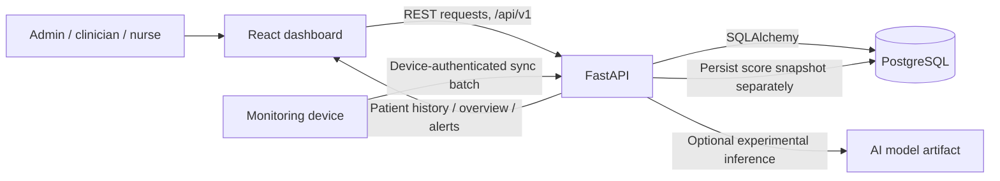

# NeoGuard

NeoGuard is an offline-aware neonatal monitoring prototype for organizing clinical staff, patients, monitoring devices, vital-sign readings, alerts, and historical trends. It combines a React dashboard, a FastAPI service, and PostgreSQL. A separate experimental AI package trains a research-only warning model.

> **Project status:** This is a development and research prototype, not a clinically validated medical device or a production-ready care system. The AI model is trained on simulated data and is not clinically validated. Thresholds are provisional and require qualified clinical review before any care use. The repository currently contains firmware display test sketches, not a complete sensor-acquisition firmware implementation.

## What the project does

- Provides sign-in for administrators, clinicians, and nurses, with role-aware and clinic-scoped access.
- Lets authorized staff manage patients, devices, monitoring sessions, alerts, and configured vital-sign thresholds.
- Accepts authenticated device sync batches and stores time-stamped readings and device telemetry in PostgreSQL.
- Uses stored readings to serve patient history and trend charts; dashboard values come from the API rather than a frontend sample-data mode.
- Tracks data freshness so staff can distinguish current readings from stale or missing data.
- Supports offline-safe sync: device event identifiers make retries idempotent, and readings retain their original session assignment.
- Optionally stores experimental model score snapshots separately from measured readings and deterministic threshold alerts.
- Keeps imported archive/training data in separate review tables instead of creating live patients or clinical readings.

## Repository map

```text
NeoGuard/
├── README.md                    # Project overview and setup (this file)
├── start-local.ps1              # Optional Windows launcher
├── LOCAL-RUN.md                 # Short local startup reference
├── backend/
│   ├── app/                     # FastAPI routes, auth, models, schemas, services
│   ├── migrations/              # Alembic database schema history
│   ├── scripts/                 # Admin bootstrap, smoke check, archive import
│   ├── tests/                   # API and PostgreSQL integration tests
│   ├── .env.example             # Backend configuration template
│   └── requirements*.txt        # Python dependencies
├── Frontend/
│   ├── src/                     # React pages, API clients, charts and components
│   ├── package.json             # Frontend scripts and dependencies
│   └── .env.example             # Frontend API configuration template
├── ai/
│   ├── train.py                 # Synthetic prototype training pipeline
│   ├── artifacts/               # Saved model artifact used by the API
│   ├── reports/                  # Training and archive audit reports
│   └── tests/                    # AI feature/model tests
└── firmware/
    ├── display_message/         # LCD display test sketch
    └── lcd_test/                # LCD test sketch
```

## System architecture and data flow



The frontend calls the backend through `/api/v1`. In local development, Vite proxies API requests to FastAPI. Devices submit readings to the device sync endpoint using a provisioned device credential. The backend validates each item, stores accepted data and generated threshold alerts, and returns per-item results. Patient history and dashboard trends are then queried from PostgreSQL through the API.

The reading's `measured_at` timestamp is distinct from the server's `received_at` timestamp. This preserves when a measurement was taken even if a device uploads it later. A reading is associated with the monitoring session it originally belonged to, including when an offline device uploads after that session has ended. Device event IDs prevent duplicate readings on retry.

There is no frontend mock-data mode. A newly configured database can therefore show empty states until staff create records and a device or an authorized integration sends real readings. The firmware sketches currently in this repository test displays; sensor collection, buffering, and device sync firmware are not implemented here yet.

## Technology

| Area | Current implementation |
|---|---|
| Frontend | React 18, Vite, React Router, Zustand, Recharts, Tailwind CSS |
| Backend | Python, FastAPI, Pydantic Settings, synchronous SQLAlchemy 2 |
| Database | PostgreSQL, managed through Alembic migrations |
| Staff security | JWT bearer access tokens, Argon2 password hashes, role and clinic access checks |
| Device security | Per-device random credential; the API stores a hash and supports credential rotation |
| AI prototype | Scikit-learn synthetic-data training pipeline and a JSON model artifact |
| Local orchestration | FastAPI development startup checks PostgreSQL and launches Vite if it is not already running |

## Start the project locally (Windows)

### Requirements

- Python and Node.js versions compatible with the dependencies in `backend/requirements.txt` and `Frontend/package-lock.json`.
- PostgreSQL installed and available locally, or the bundled local PostgreSQL runtime/data directory if your workspace provides it.
- PowerShell for the commands below and the optional `start-local.ps1` script.

### First-time setup

Run these commands from the repository root in PowerShell:

```powershell
py -m venv backend/.venv
backend/.venv/Scripts/python.exe -m pip install -r backend/requirements-dev.txt

Copy-Item backend/.env.example backend/.env
Copy-Item Frontend/.env.example Frontend/.env

Push-Location Frontend
npm ci
Pop-Location
```

Edit `backend/.env` and set:

- `DATABASE_URL` to the PostgreSQL database and credentials for this project.
- `JWT_SECRET_KEY` to a unique random secret of at least 32 characters. For example, generate one with `py -c "import secrets; print(secrets.token_urlsafe(48))"` and paste the output into the ignored `.env` file.
- `BOOTSTRAP_ADMIN_USERNAME` and `BOOTSTRAP_ADMIN_EMAIL` if you want different initial admin identifiers. Leave `BOOTSTRAP_ADMIN_PASSWORD` empty to enter the password interactively when creating the account.

Never commit `.env` files or share their secrets. The repository's `.gitignore` excludes them.

Create the PostgreSQL role and database if they do not already exist. For example, in a PostgreSQL shell as a database administrator:

```sql
CREATE ROLE neoguard LOGIN PASSWORD 'choose-a-local-password';
CREATE DATABASE neoguard OWNER neoguard;
```

Make `DATABASE_URL` use the same username, password, host, port, and database. Then run the migrations and create the initial admin account:

```powershell
Push-Location backend
.\.venv\Scripts\python.exe -m alembic upgrade head
.\.venv\Scripts\python.exe -m scripts.seed_admin
Pop-Location
```

The seed command creates the administrator and provisional threshold rows. It prompts for an admin password when `BOOTSTRAP_ADMIN_PASSWORD` is blank. It does not print or recover an existing admin password; reset credentials through an authorized operational process.

### Run the whole local application

From the repository root:

```powershell
Push-Location backend
..\.venv\Scripts\python.exe -m uvicorn app.main:app --host 127.0.0.1 --port 8000
```

In development mode, FastAPI checks that the configured PostgreSQL database accepts connections and starts Vite on port `5173` if the expected frontend is not already running. It can start a single installed PostgreSQL Windows service or the bundled local PostgreSQL runtime when available. Schema migrations remain a manual setup/upgrade step. Stop Uvicorn with `Ctrl+C`; it also stops the Vite process that it started. PostgreSQL remains running.

Open:

- Frontend: <http://127.0.0.1:5173>
- API health: <http://127.0.0.1:8000/health>
- Interactive API docs: <http://127.0.0.1:8000/docs> (disabled when `APP_ENV=production`)

Alternatively, run `./start-local.ps1` from the repository root after configuring the environment. The launcher checks dependencies and service readiness and prints the local URLs.

To run the frontend and backend separately, start the backend from `backend/` as above and run `npm run dev` from `Frontend/`. The Vite development server proxies `/api` requests to `http://127.0.0.1:8000`. For a separately hosted frontend, set `VITE_API_BASE_URL` in `Frontend/.env` and configure the deployed origin in backend `CORS_ORIGINS`.

## Main application areas

### Staff dashboard

- **Nurse and clinician views:** ward overview, patient list, patient details, vitals and trend history, active monitoring sessions, alerts, and device information.
- **Administrator views:** system overview, staff accounts and access requests, clinic configuration, device registry/health, sessions, and threshold settings.
- **Authentication:** username or email sign-in, forced password change for temporary credentials, and role-aware protected routes.
- Charts and KPI values are driven by API responses. Empty and stale states are shown when there are no recent readings.

### Backend API

The API prefix is `/api/v1`. The interactive OpenAPI documentation is available at `/docs` in development. Major endpoint groups include:

| Endpoint group | Purpose |
|---|---|
| `/auth` | Staff login, current user, password change, staff provisioning, access requests and administration |
| `/patients` | Patient records, risk profiles, reading history and experimental risk-score availability |
| `/devices` | Device registry, current device session, health/telemetry, secret rotation and device sync |
| `/sessions` | Start, list and stop patient/device monitoring assignments |
| `/alerts` | List/filter alerts and record staff acknowledgment |
| `/admin` | Administrative overview, clinic/user management and device health summaries |
| `/thresholds` | Read and configure rule-based alert thresholds |

Device ingestion uses `POST /api/v1/devices/sync`. Staff endpoints use staff bearer tokens; device sync uses the provisioned device bearer credential. The API validates value ranges, device/session ownership, timestamps, payload size, and duplicate event identifiers. Valid batch items receive accepted, duplicate, or rejected outcomes according to the sync contract.

### Database

PostgreSQL is the source of truth. Alembic migrations define and upgrade the schema; SQLAlchemy models represent its entities. Major data areas include:

- Clinics and staff users, including roles, password lifecycle state, and token versions.
- Patients and clinician-maintained risk profiles.
- Devices, hashed device credentials, registered components, telemetry, and component health.
- Monitoring sessions that link a clinic, patient, and device with database-enforced active-session constraints.
- Time-stamped readings and threshold alerts, including alert acknowledgment records.
- Versioned threshold configuration and audit records.
- Model registry and experimental risk-score snapshots.
- Separate archive import and research dataset tables for review-only data.

Run `alembic upgrade head` from `backend/` whenever pulling a schema migration. Do not use `Base.metadata.create_all()` as a substitute for migrations.

### AI and research data

The `ai/` package generates simulated monitoring sessions, trains an exploratory warning model, and writes a model artifact and reports. The API can load this artifact when `AI_MODE=prototype`; set `AI_MODE=disabled` to turn off model scoring. Threshold-based alerts operate independently of model availability. Model outputs are marked as synthetic research estimates and are not diagnoses or validated clinical probabilities.

The archive audit/import path stages de-identified research records in separate dataset tables for review. It does not insert imported subjects into the live patient table or turn archive rows into clinical readings. Review `ai/README.md` and `backend/docs/archive-data-storage.md` for model and archive details.

## Security and operational notes

- Staff passwords are stored as hashes, and JWT secrets must be unique and private.
- Temporary staff passwords require a password change and expire; password changes/reset invalidate existing access tokens.
- Device credentials are generated per device, stored as hashes, and can be rotated. A newly provisioned device secret is returned once; save it securely.
- Non-admin staff access is scoped to their clinic. Use the least privileged role needed.
- Do not put real patient identifiers or clinical data in commits, screenshots, test fixtures, or training reports.
- Configure explicit production `CORS_ORIGINS`; wildcard origins and localhost origins are rejected for production settings.
- Apply TLS, backups, access review, retention rules, monitoring, and deployment-specific secret management before any deployment beyond local development.
- Provisional threshold defaults require clinical review and approval before being used for care decisions.

## Development and verification

Install backend development dependencies with `backend/requirements-dev.txt` and frontend dependencies with `npm ci` in `Frontend/`.

Useful commands from the repository root:

```powershell
# Backend contract and PostgreSQL-backed API smoke flow (requires configured DB and migrations)
Push-Location backend
.\.venv\Scripts\python.exe -m scripts.smoke_test_live
Pop-Location

# Frontend production build
Push-Location Frontend
npm run build
Pop-Location

# Python and AI unit tests
backend/.venv/Scripts/python.exe -m pytest -q
```

PostgreSQL integration tests require `NEOGUARD_TEST_DATABASE_URL` to point to a dedicated test database. Use a disposable database; the tests create and clean up their own test schema. Do not point integration tests at a database containing project or patient records.

The live smoke script exercises the configured API and PostgreSQL flow, including authentication/access controls, patient/device/session creation, device sync and deduplication, stored history, alerts, and device health; it cleans up the temporary records it creates. Read its output before using it against any shared environment.

## Current limits and next integration boundary

- No complete sensor-reading firmware, offline device queue, or hardware-to-API integration is included yet. `firmware/` currently contains display test sketches.
- The database and API can store device-submitted vitals and serve historical trends, but an actual monitoring device or another trusted producer must send those readings.
- The AI model uses simulated data and has no clinical validation. Archive data is staged for review and is not clinical ground truth.
- This repository is not a replacement for clinical judgment, a validated alarm system, or a regulated medical device.

## Additional documentation

- [Local run notes](LOCAL-RUN.md)
- [AI prototype and reproducibility](ai/README.md)
- [Research archive storage notes](backend/docs/archive-data-storage.md)
- [MIT License](LICENSE)
